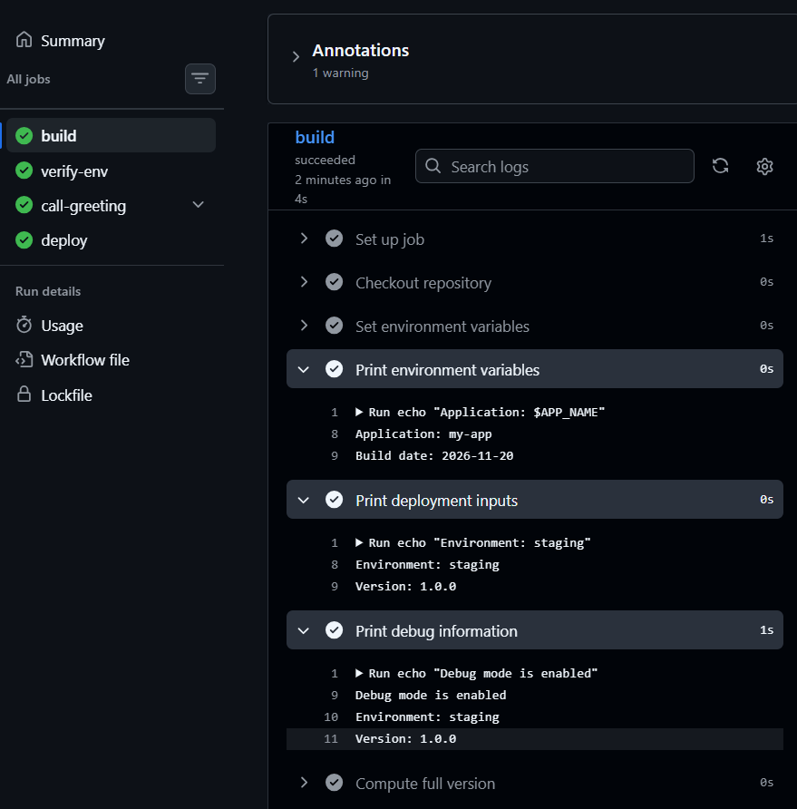
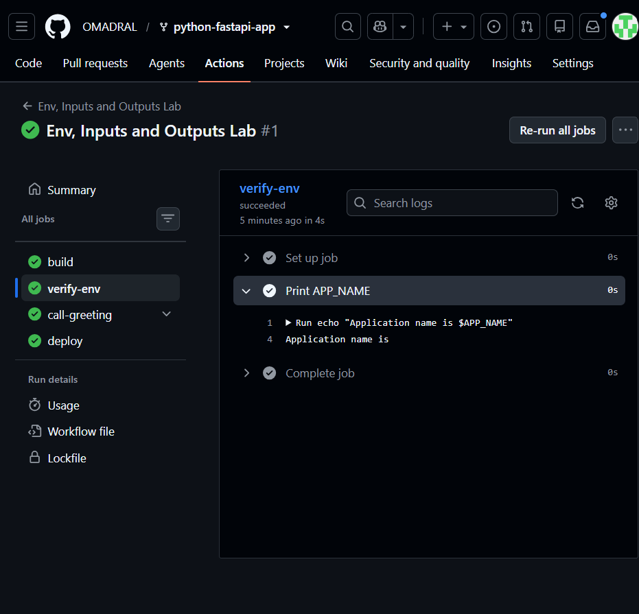
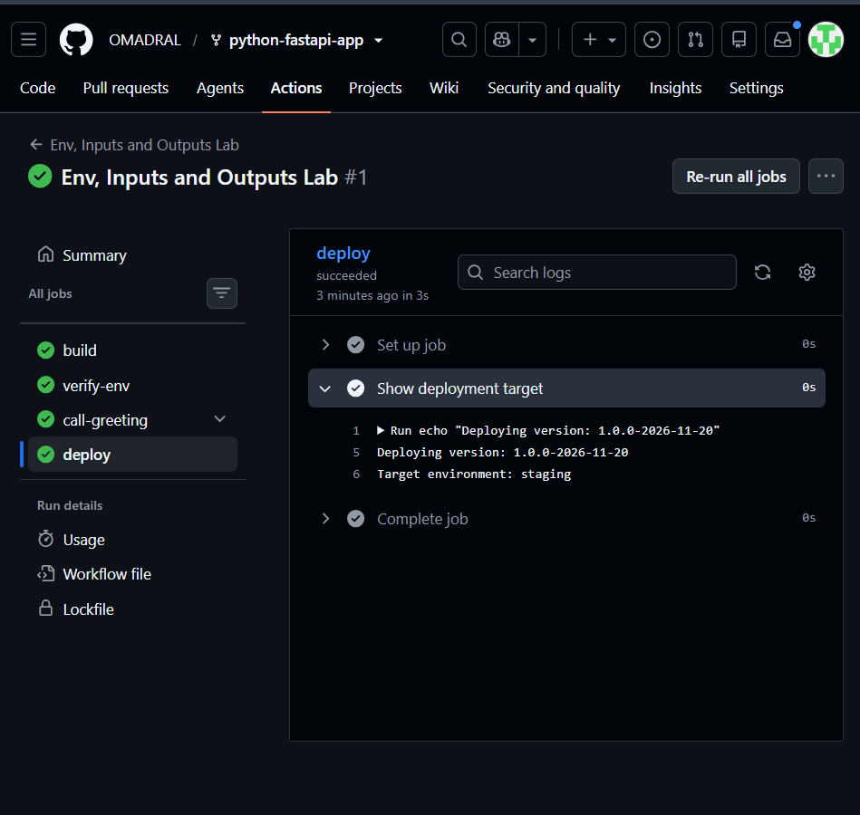

# TP6 – Variables d'environnement, Inputs et Outputs

## Q1. Pourquoi GITHUB_ENV ?

GITHUB_ENV permet de partager les variables d'environnement
entre les différentes steps d'un même job.

### Capture d'écran

---

## Q2. Quelle est la portée de GITHUB_ENV ?

Les variables sont disponibles dans les steps suivantes
du même job, mais pas dans les autres jobs.

### Capture d'écran

---

## Q3. Différence entre > et >>

L'opérateur >> ajoute une nouvelle valeur tandis que >
remplace le contenu précédent du fichier.

## Q4. Différence entre GITHUB_ENV et GITHUB_OUTPUT

GITHUB_ENV partage les variables entre steps.
GITHUB_OUTPUT permet de transmettre des outputs entre jobs
avec needs.

### Capture d'écran

---

## Q5. Que se passe-t-il si on retire needs ?

Le job deploy peut s'exécuter indépendamment du job build.
Il ne peut alors plus récupérer correctement les outputs
de build via needs.build.outputs.